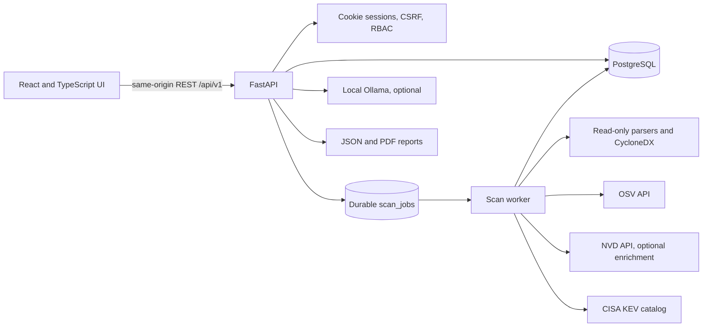

# DepShield

**DepShield – AI-Powered Software Supply Chain Security and Vulnerability Intelligence Platform**

DepShield is a defensive, locally runnable application for analyzing dependency manifests, producing a CycloneDX SBOM, querying public vulnerability intelligence, prioritizing findings with an explainable heuristic, and exporting scan reports. Uploaded files are treated as untrusted data: the scanner does not install packages, execute source code, or run project build scripts.

> **Project status:** this workspace includes the implemented feature set described below. Unit, UI, build and service checks are recorded in [DEVELOPMENT_STATUS.md](DEVELOPMENT_STATUS.md) and [TEST_REPORT.md](TEST_REPORT.md). PostgreSQL integration and browser end-to-end checks should be run in an isolated test environment; do not treat a partial scan as a clean result.

## Features currently implemented

- React, TypeScript and Vite client with responsive dashboard, projects, scan history, inventory, findings, administrator controls, light/dark themes, and accessible empty/loading/error states.
- FastAPI REST API, PostgreSQL models and Alembic initial migration.
- Argon2 password hashing, opaque HttpOnly cookie sessions, CSRF cookie/header checks, account registration/login/logout, password change/reset, account deletion, role checks and owner/member object authorization.
- Project edit/archive/restore/delete, Auditor share/revoke, scan comparison, admin job/audit/service-health views, session revocation and configured scan-snapshot retention.
- PostgreSQL-backed, retry-limited scan queue and separate worker process.
- Read-only parsing of `requirements.txt`, npm `package-lock.json` versions 1–3, `pom.xml`, `go.mod`, `Cargo.lock`, and ZIP archives containing those files. Unverified declared versions are labelled and can be queried as declared evidence; they are never represented as confirmed installed versions.
- ZIP path, symbolic link, entry count, total expanded size, manifest size, and component count limits. XML parsing uses `defusedxml`.
- OSV batch matching, best-effort NVD enrichment, CISA KEV lookup, timeouts/retries, a PostgreSQL OSV response cache, and degraded scan status when required evidence is unavailable.
- Deterministic risk score, CycloneDX JSON SBOM, on-demand local Ollama explanation with labelled deterministic fallback, JSON and PDF report endpoints.
- Security Center: CycloneDX 1.4–1.6 import/structural validation, snapshot comparisons and OSV checks for imported package URLs.
- Per-project security policy with persisted scan gate results; CI example and client at `docs/examples/depshield-policy-gate.yml` and `ci/security_policy_gate.py`.
- Evidence-based upgrade suggestions from OSV fixed-version ranges, with JSON/PDF output and optional local AI explanation; recommendations never modify manifests.
- Package license inventory with registry evidence, allowed/restricted license policy review, and JSON/PDF reports. Unknown license evidence stays marked for review.
- Durable scheduled rescans, project-owner in-app notifications, idempotent alert events, and optional SMTP email notifications.
- GitHub Actions workflow for backend, PostgreSQL integration, frontend, dependency audit and Playwright full-stack checks.
- Safe historical educational fixtures. They are not installed or executed by DepShield.

## Architecture



See [architecture](docs/ARCHITECTURE.md), [database design](docs/DATABASE_DESIGN.md), and [API notes](docs/API_DOCUMENTATION.md).

## Technology

- **Frontend:** React 18, TypeScript, Vite, React Router, TanStack Query, configured Tailwind tooling with authored CSS, Recharts, Lucide.
- **Backend:** Python 3.12, FastAPI, Pydantic 2, SQLAlchemy 2, Alembic, HTTPX, Argon2id (`pwdlib`), ReportLab.
- **Database:** PostgreSQL 16. SQLite is not used.
- **Intelligence:** OSV, NVD (no key required; optional key supported), CISA KEV, optional local Ollama.
- **Deployment and checks:** Docker Compose, Pytest, Ruff, Vitest, ESLint, TypeScript.

## Prerequisites

For native development install Python 3.12+, PostgreSQL 16+, Node.js 22.13+, 24, or 26+, npm, and Git. Docker Desktop with Compose is optional. Ollama is optional. No paid API key or hosted database is required.

## Quick start: Windows PowerShell

1. Install the prerequisites and start PostgreSQL, or use Docker Compose.
2. From the workspace root run:

   ```powershell
   .\scripts\setup.ps1
   ```

   The script creates `.env` once with random local secrets and installs the pinned dependencies. It keeps an existing `.env` unchanged. On the QA machine, system Python, PostgreSQL, and Docker were unavailable; backend checks used a project-local virtual environment, and the full setup/startup workflow was not run.

3. Create a PostgreSQL database and user, then set `DATABASE_URL` in `.env`. With local PostgreSQL, the example is `postgresql+psycopg://depshield:<password>@localhost:5432/depshield`.
4. Start the API and worker in separate PowerShell terminals:

   ```powershell
   Set-Location .\backend
   .\.venv\Scripts\python.exe -m alembic upgrade head
   .\.venv\Scripts\python.exe -m uvicorn app.main:app --reload --host 127.0.0.1 --port 8000
   ```

   ```powershell
   Set-Location .\backend
   .\.venv\Scripts\python.exe -m app.workers.scan_worker
   ```

5. In a third terminal run:

   ```powershell
   Set-Location .\frontend
   npm.cmd run dev
   ```

   Use the Vite URL printed in the terminal (normally `http://localhost:5173`). The Vite proxy forwards `/api/v1` and `/health` to FastAPI. Use `npm.cmd` in PowerShell if script execution policy blocks `npm.ps1`.
6. Register a Developer account. To create an Administrator, use the interactive command in [Administrator setup](#administrator-setup).

## Quick start: Linux and macOS

1. Install Python 3.12+, PostgreSQL 16+, Node.js 22.13+, 24, or 26+, and npm. Create the local database role and database with `sudo -u postgres createuser --pwprompt depshield` and `sudo -u postgres createdb --owner=depshield depshield`.
2. Run `sh ./scripts/setup.sh`. It creates `.env` with random local secrets when needed, creates `backend/.venv`, installs the pinned backend requirements, and runs `npm ci` from the frontend directory. It leaves an existing `.env` unchanged.
3. Edit `DATABASE_URL` in `.env` to use the password entered for the PostgreSQL role. `APP_SECRET` is generated by the setup script.
4. In separate terminals from the workspace root, run:

   Use a separate terminal for each service:

   ```sh
   cd backend && .venv/bin/python -m alembic upgrade head
   ```

   ```sh
   cd backend && .venv/bin/python -m uvicorn app.main:app --reload --host 127.0.0.1 --port 8000
   ```

   ```sh
   cd backend && .venv/bin/python -m app.workers.scan_worker
   ```

   ```sh
   cd frontend && npm run dev
   ```

   Open the frontend URL printed by Vite, normally `http://localhost:5173`. Use `python3` for environment setup; the `.venv` interpreter is used for all backend commands.
5. Register a Developer account. Create an Administrator with `cd backend && .venv/bin/python ../scripts/create_admin.py`.

## Quick start: Docker Compose

1. Run `scripts/setup.ps1` once (or copy `.env.example` to `.env` and generate a unique `APP_SECRET` and `POSTGRES_PASSWORD`).
2. Set the same `POSTGRES_PASSWORD` in `.env`; Compose passes it into the PostgreSQL URL for the containers.
3. Start the stack:

   ```powershell
   docker compose up --build -d
   ```

4. Open `http://localhost:5173`. FastAPI OpenAPI is available directly at `http://localhost:8000/docs`; PostgreSQL is only reachable on the private Compose network.
5. Create the administrator from the backend container:

   ```powershell
   docker compose exec api python /scripts/create_admin.py
   ```

   The command prompts for a password and creates no default credentials.

To open Mailpit for local password-reset email, start Compose with `--profile mail` and set `SMTP_HOST=mailpit`, `SMTP_PORT=1025` in `.env`; the inbox is at `http://localhost:8025`. Ollama is optional; use `--profile ai` for the bundled Ollama container or set `OLLAMA_DOCKER_URL=http://host.docker.internal:11434` to reach a host install, set `OLLAMA_ENABLED=true`, and pull the selected model. Model downloads can require substantial disk space.

## Administrator setup

After the API environment and database are configured:

```powershell
Set-Location .\backend
..\.venv\Scripts\python.exe ..\scripts\create_admin.py
```

The CLI prompts for email, display name, and a new 12+ character password. No default administrator credentials are shipped. Administrator grants are not available through public registration or the web role editor.

## Using the scanner

1. Register or sign in.
2. Create a project and choose its primary ecosystem.
3. Upload a supported manifest or ZIP archive.
4. Keep the worker running and open the queued scan to watch real stage/status updates.
5. Review the dependency inventory, findings, official severity, DepShield heuristic score, KEV state, source status, and fix versions where supplied.
6. Download CycloneDX JSON, a JSON report, or a PDF report.

For Go `go.mod`, Maven POMs, and `requirements.txt`, a declared version is not proof of the version installed in an environment. DepShield preserves that uncertainty. Cargo/npm lockfiles carry stronger version evidence. Transitive/direct status is `unknown` when it cannot be established from the provided files.

## Risk heuristic

`round(CVSS × 6)` (0–60) + 25 for CISA KEV known exploitation + 10 for a confirmed direct dependency + 5 when OSV supplies a fixed version, capped at 100. Priority categories are Critical 85–100, High 65–84, Medium 40–64, and Low 0–39. Missing CVSS produces `Unknown`, not zero. This is an academic prioritization heuristic, not a certified risk standard. Official severity is shown separately.

## Password reset email

Configure `SMTP_HOST`, `SMTP_PORT`, `SMTP_FROM`, and optional SMTP credentials in `.env`. The endpoint returns the same generic response regardless of whether an account exists. Reset tokens are single-use, hashed in PostgreSQL, and never returned by the API. Without SMTP configured, reset requests are accepted but no mail is sent. Mailpit is a local testing option.

## Ollama

Set `OLLAMA_ENABLED=true`, `OLLAMA_BASE_URL`, and `OLLAMA_MODEL`. The assistant receives only structured advisory and package metadata, treats those fields as untrusted, validates JSON output, and cannot modify projects or run commands. If Ollama is off or unreachable, the UI clearly labels its deterministic fallback. AI output is advice that requires review.

## Tests and checks

From the workspace root:

```powershell
.\scripts\test.ps1
```

The script runs backend unit tests and Ruff, then frontend Vitest, ESLint, TypeScript checking, and a Vite production build. For PostgreSQL integration and migrations, use a separate test database and run the checks described in [TESTING.md](docs/TESTING.md). End-to-end Playwright coverage and automated accessibility/device checks are not yet implemented. `TEST_REPORT.md` records the checks actually run during development; missing tools are identified as unverified.

## API

- Frontend: `http://localhost:5173`
- Backend: `http://localhost:8000`
- OpenAPI: `http://localhost:8000/docs`
- Liveness: `http://localhost:8000/health/live`
- Readiness: `http://localhost:8000/health/ready`
- Versioned API prefix: `/api/v1`

See [API_DOCUMENTATION.md](docs/API_DOCUMENTATION.md) and the generated OpenAPI document for endpoint payloads.

## Security and privacy

Review [SECURITY.md](docs/SECURITY.md), [THREAT_MODEL.md](docs/THREAT_MODEL.md), and [PRIVACY_CHECKLIST.md](docs/PRIVACY_CHECKLIST.md). Production requires HTTPS, a non-default secret, secure cookies, restricted origins, SMTP configuration, backups, service-specific rate limiting, and operator/legal review. The rate limiter in this foundation is in-memory and is not suitable as a distributed production control.

## Troubleshooting

- **`npm.ps1 cannot be loaded`:** use `npm.cmd` in PowerShell.
- **No scan progress:** make sure the worker is running and PostgreSQL is reachable.
- **Partial result:** inspect `intelligence_status`; OSV/KEV availability and unresolved manifest versions are visible on the scan.
- **No password reset email:** configure SMTP. With Mailpit, read the inbox at `http://localhost:8025`.
- **PostgreSQL connection error:** check the database is started, `DATABASE_URL` user/password/database are correct, and migrations ran.
- **Old scan snapshots:** the worker removes terminal scans older than `DATA_RETENTION_DAYS` once per day. Project and account records remain until explicitly deleted; audit events have a separate retention policy and are not currently pruned automatically.
- **Ollama unavailable:** core scanning still works. Keep Ollama disabled or start its service and confirm the configured model is present.
- **Supported filename inside ZIP not found:** only recognized manifest basenames are parsed; archive content is never extracted to disk.

## Documentation and project report

- [Demo guide](DEMO_GUIDE.md)
- [Architecture](docs/ARCHITECTURE.md)
- [Database design](docs/DATABASE_DESIGN.md)
- [Security](docs/SECURITY.md) and [threat model](docs/THREAT_MODEL.md)
- [Testing](docs/TESTING.md) and [test report](TEST_REPORT.md)
- [Deployment](docs/DEPLOYMENT.md) and [user guide](docs/USER_GUIDE.md)
- [Academic project report](docs/PROJECT_REPORT.md)
- [Viva questions](docs/VIVA_QUESTIONS.md)
- [Third-party audit](docs/THIRD_PARTY_AUDIT.md) and [notices](THIRD_PARTY_NOTICES.md)
- [Development status](DEVELOPMENT_STATUS.md)
- [UI redesign report](UI_REDESIGN_REPORT.md)

## Packaging

Run `python scripts/package_project.py` from the workspace root to create `output/DepShield_Complete_Project.zip`. The script excludes environments, dependency caches, `.env`, database files, logs and build output, then checks the ZIP integrity.
