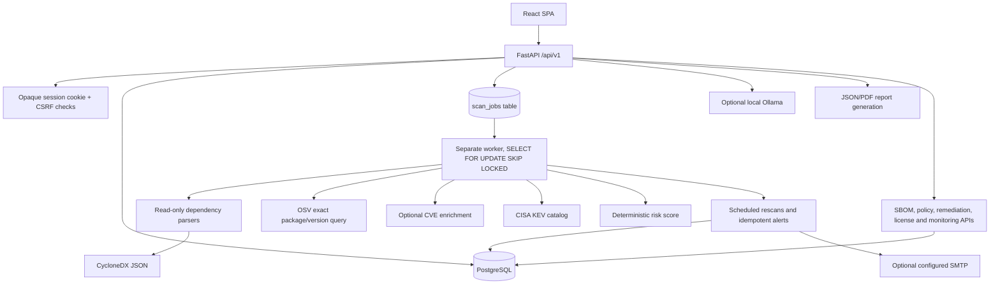
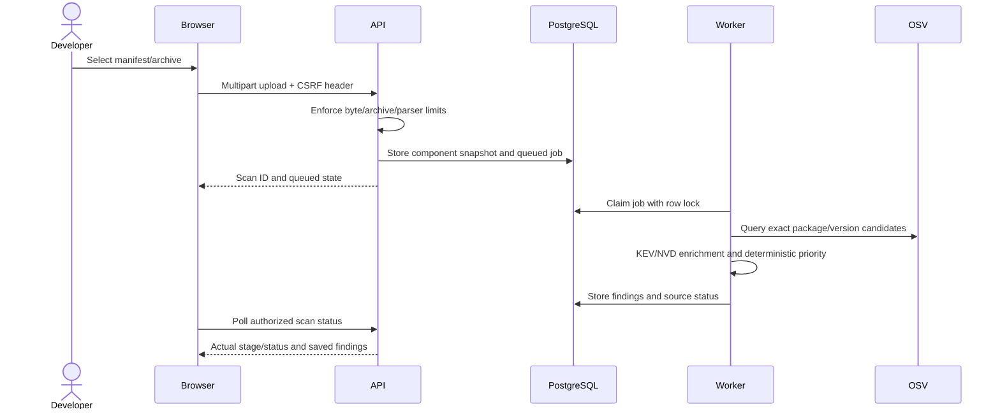

# Architecture

## Runtime boundaries

The API stores the scan snapshot and job in a PostgreSQL transaction. The worker claims jobs with `FOR UPDATE SKIP LOCKED`, updates visible stage/status, and reclaims stale processing jobs after a timeout. OSV queries batch exact version candidates; unresolved version ranges are not sent. Declared pins from manifests without lock resolution may be queried as declared candidates, but the scan is marked partial to preserve the installation uncertainty.

The Security Center operates on saved project and scan evidence. Imported CycloneDX JSON is structurally validated and stored with the project. Policy evaluation records its result on the scan; recommendations use explicit OSV fixed-version/range evidence and never rewrite source files. License metadata refresh contacts fixed public package registries and stores source evidence. Monitoring uses a persisted schedule row and the same durable scan queue; it clones parsed component inventory because uploaded manifest bytes are not retained. Alert keys are unique per user/event, and email is an optional SMTP outbox delivery.

Uploaded bytes are read into bounded memory, parsed, hashed, and discarded. The database keeps the sanitized source filename, size, digest, parsed components, advisory matches and report metadata. ZIP files are read in place; archive members are never extracted. Uploaded code and package install scripts are never executed.

## Scan data flow

## Security controls

- Argon2id password hashes, random opaque sessions, HMAC digests at rest, HttpOnly SameSite cookies, CSRF double-submit token, per-IP in-memory auth throttles, and account status checks.
- Every project/scan/finding/report request checks project ownership, explicit read-only membership, or administrator role.
- The API validates JSON with Pydantic and uses SQLAlchemy parameterized queries.
- Production settings reject non-HTTPS frontend origins, non-secure cookies, weak secrets and local/default database URLs.
- Security headers are added by the API; Nginx adds CSP in the Compose frontend.
- AI receives structured advisory/package evidence only; local Ollama is optional and cannot execute commands or alter scan results.

## Known boundaries

The current rate limiter and NVD/KEV caches are process-local; use shared storage before multi-worker production deployment. Syft and OSV-Scanner are not invoked. There is no distributed queue broker, cloud service, or external AI provider. Generated-report metadata, AI explanation history, audit retention, deletion-request review and deletion backup expiry need further design and operational validation. The local PostgreSQL integration test and browser run do not constitute load, penetration or recovery certification. Account deletion is immediate after current-password confirmation.
