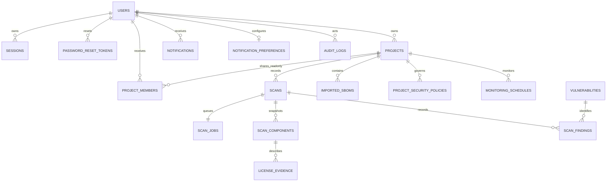

# Database design

PostgreSQL is the primary database. Alembic migrations are authoritative: `0001_initial.py` creates the application core and additive `0002_security_center.py` adds the security-center records. Never edit an already applied migration in a deployed database. Use a dedicated database ending in `_test` for PostgreSQL integration tests.

## Entity relationships

## Important constraints and indexes

- Unique emails, session/reset digests, OSV identifiers, one scan job per scan, membership per user/project, and finding per scan/component/vulnerability.
- Project policies, imported SBOMs, monitoring schedules and license evidence are constrained by project/component foreign keys. A monitoring schedule is unique per project. Notification event keys are unique per user to make alert generation idempotent.
- User roles are Developer, Administrator or Auditor. Project membership is read-only. Component directness and scan/job statuses use constrained values.
- `scan_findings.affected_ranges` preserves bounded OSV range evidence; `scans.policy_result` stores the evaluated policy decision and evidence.
- Project deletion cascades through project scan snapshots and associated SBOM/policy/schedule records; global vulnerability records are retained. Existing account-deletion behavior is documented in the security and privacy guides.

## Tables

Core migration: `users`, `sessions`, `password_reset_tokens`, `projects`, `project_members`, `scans`, `scan_jobs`, `scan_components`, `vulnerabilities`, `intelligence_cache`, `scan_findings`, and `audit_logs`.

Security-center migration: `imported_sboms`, `project_security_policies`, `license_evidence`, `monitoring_schedules`, `notification_preferences`, and `notifications`.

All timestamps are timezone-aware UTC values. Transactions commit related state together. Uploaded source bytes are parsed, hashed, and discarded; scheduled rescans reuse persisted parsed component inventory rather than retaining raw manifests. OSV response cache payloads are stored in PostgreSQL; KEV and NVD caches remain worker-process memory caches.
